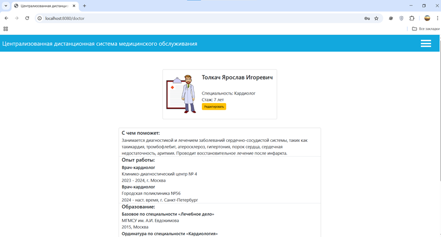
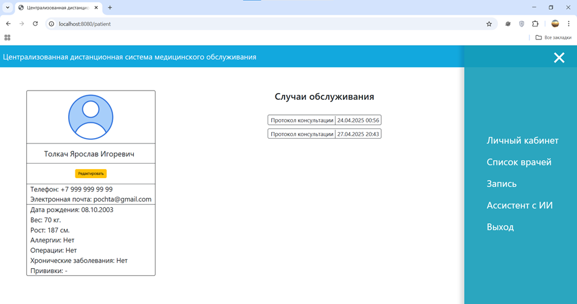
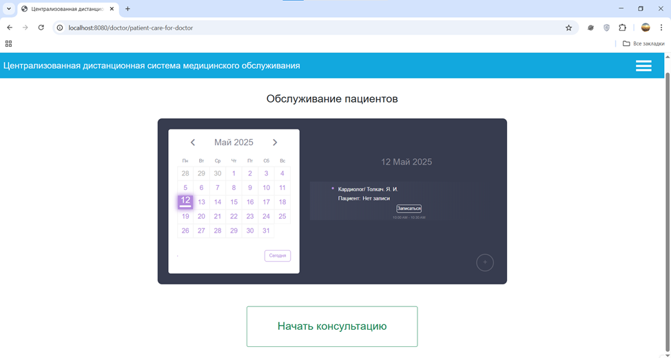
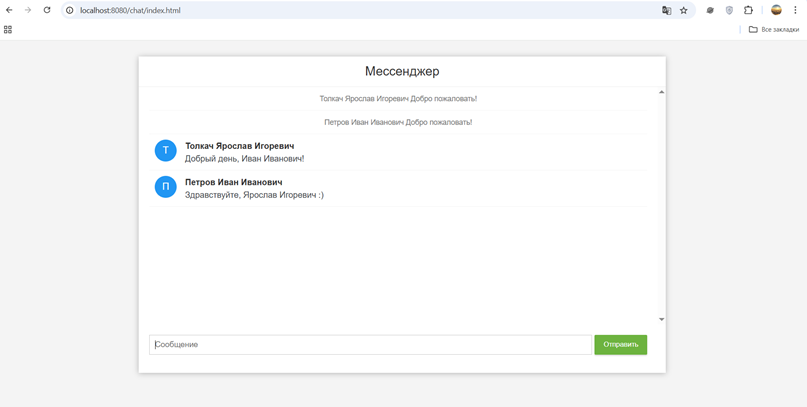
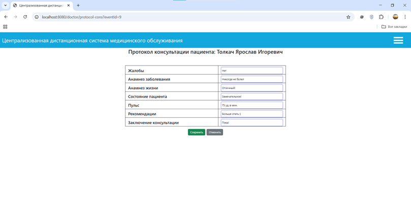
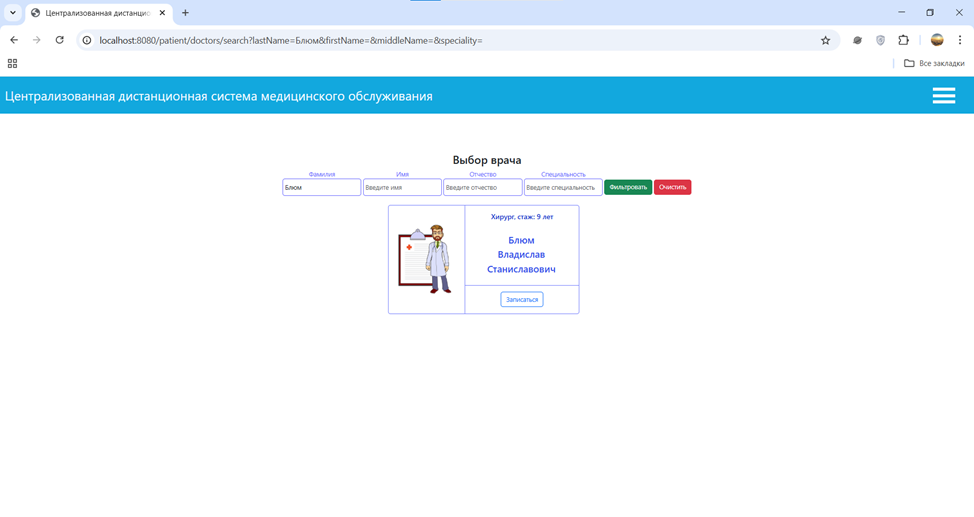
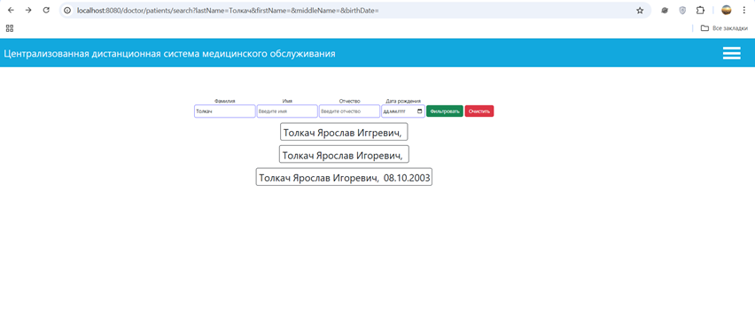

# Централизованная дистанционная система медицинского обслуживания
Телемедицинская система, предназначенная для проведения дистанционных консультаций между врачом и пациентом, а также ведения медицинской документации по их итогам. В перспективе планируется реализовать передачу сформированных электронных медицинских документов в федеральную подсистему ЕГИСЗ — Реестр электронных медицинских документов.

## Содержание

- [Функции системы](#функции-системы)
    - [Личный кабинет](#личный-кабинет)
    - [Создание расписания и запись](#создание-расписания-и-запись)
    - [Мессенджер](#мессенджер)
    - [Медицинское документирование](#медицинское-документирование)
    - [Поиск пользователей](#поиск-пользователей)
- [Технологический стек](#технологический-стек)
- [Архитектура системы](#архитектура-системы)
- [Требования для запуска](#требования-для-запуска)

## Функции системы
### Личный кабинет
В системе предусмотрены личные кабинеты врача и пациента, позволяющие просматривать и редактировать информацию о пользователе.

В зависимости от роли пользователю доступны соответствующие сведения:
- Врачу — информация о пациентах;
- Пациенту — информация о врачах доступных для записи на консультацию.

  

  

### Создание расписания и запись
Врач может создать расписание, добавляя свободные временные интервалы для записи. Пациент может просматривать доступные талоны и записываться на удобное время.

  

### Мессенджер
Для информационного взаимодействия между врачом и пациентом предусмотрен встроенный мессенджер.
Использование собственного модуля обмена сообщениями позволяет организовать коммуникацию в рамках системы и учитывать требования к конфиденциальности медицинской информации.

  

### Медицинское документирование
По итогам консультации врач фиксирует сведения о проведённом случае обслуживания в протоколе консультации пациента.

  

### Поиск пользователей
#### Поиск медицинского специалиста
Пациент может искать врача по фамилии, имени, отчеству и специальности.

  

#### Поиск пациента
Врач может искать пациента по фамилии, имени, отчеству и дате рождения.

  

## Технологический стек
В проекте используются следующие технологии:
- Java — язык программирования, используемый для реализации серверной бизнес-логики;
- Spring Boot — фреймворк для разработки серверной части приложения;
- PostgreSQL — реляционная система управления базами данных, предназначенная для хранения и обработки данных приложения;
- JavaScript — язык программирования, используемый для реализации клиентской логики и взаимодействия с серверной частью;
- HTML — язык разметки для формирования структуры пользовательского интерфейса;
- CSS — язык стилей для оформления пользовательского интерфейса;
- Maven — инструмент управления зависимостями, автоматизации сборки и управления жизненным циклом проекта.

## Архитектура системы
Система состоит из клиентской и серверной частей:
- Клиентская часть отвечает за отображение пользовательского интерфейса, взаимодействие с пользователем и отправку запросов на сервер;
- Серверная часть реализует бизнес-логику приложения, обрабатывает запросы от клиента и взаимодействует с базой данных.

Для хранения и обработки данных, необходимых для работы приложения, используется база данных.
Взаимодействие между клиентской и серверной частями осуществляется посредством REST API.

## Требования для запуска
- JDK 23;
- PostgreSQL;
- Современный веб-браузер.

